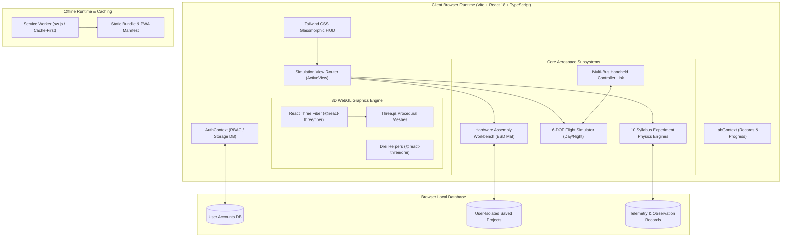
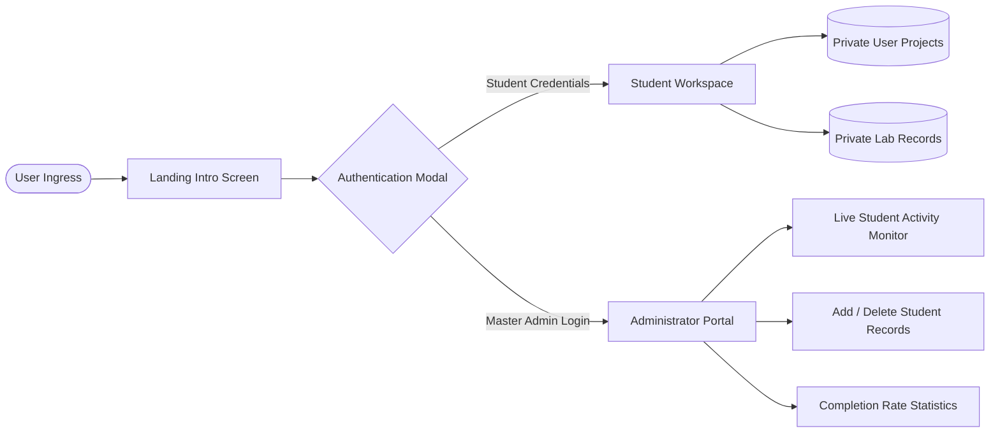
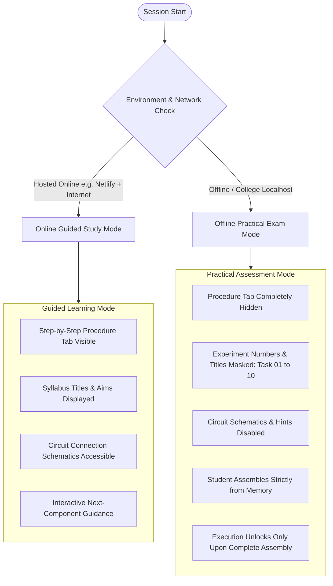
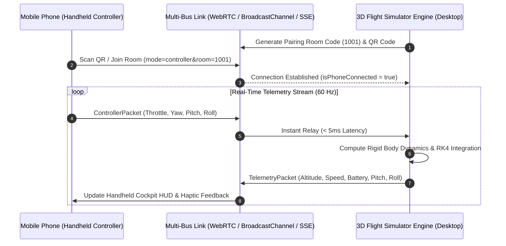

# AERO - SPACE SIMULATOR: ADVANCED 3D AEROSPACE VIRTUAL LABORATORY & AUTONOMOUS UAV SIMULATION PLATFORM

**Department of Aeronautical & Aerospace Engineering**  
**Autonomous Systems, Avionics & Flight Dynamics Simulation Infrastructure**  
*System Architecture, Theoretical Framework, Syllabus Laboratory Manual & Technical Documentation*  
*Version 2.4.0 (Production Release)*

---

## TABLE OF CONTENTS
1. [EXECUTIVE SUMMARY & ABSTRACT](#1-executive-summary--abstract)
2. [SYSTEM ARCHITECTURE & SOFTWARE STACK](#2-system-architecture--software-stack)
3. [SECURITY, PRIVACY & ROLE-BASED ACCESS CONTROL (RBAC)](#3-security-privacy--role-based-access-control-rbac)
4. [DUAL-MODE PEDAGOGICAL FRAMEWORK: ONLINE STUDY VS. OFFLINE EXAM](#4-dual-mode-pedagogical-framework-online-study-vs-offline-exam)
5. [3D INTERACTIVE ASSEMBLY WORKBENCH ENGINE](#5-3d-interactive-assembly-workbench-engine)
6. [SYLLABUS EXPERIMENTAL PROTOCOLS & OBSERVATION MANUAL (EX 1 – 10)](#6-syllabus-experimental-protocols--observation-manual-ex-1--10)
   - [6.1 Experiment 1: Payload and Weight Estimation](#61-experiment-1-payload-and-weight-estimation)
   - [6.2 Experiment 2: Fixed Wing UAV Frame and Avionics Components Assembling](#62-experiment-2-fixed-wing-uav-frame-and-avionics-components-assembling)
   - [6.3 Experiment 3: Calibration and Estimation of Motor's Thrust with Various ESCs and Propellers](#63-experiment-3-calibration-and-estimation-of-motors-thrust-with-various-escs-and-propellers)
   - [6.4 Experiment 4: UAV Control Testing & Trimming Procedure using Transmitter and Servo](#64-experiment-4-uav-control-testing--trimming-procedure-using-transmitter-and-servo)
   - [6.5 Experiment 5: Lithium Polymer Battery Testing, Balancing and Maintenance](#65-experiment-5-lithium-polymer-battery-testing-balancing-and-maintenance)
   - [6.6 Experiment 6: RC Transmitter Resetting, Calibration and Frequency Binding](#66-experiment-6-rc-transmitter-resetting-calibration-and-frequency-binding)
   - [6.7 Experiment 7: Propeller Balancing Procedure](#67-experiment-7-propeller-balancing-procedure)
   - [6.8 Experiment 8: Fixed Wing UAV Centre of Gravity Calculation and Balancing](#68-experiment-8-fixed-wing-uav-centre-of-gravity-calculation-and-balancing)
   - [6.9 Experiment 9: Drone Base and Avionic components assembling in Quadcopter Configuration](#69-experiment-9-drone-base-and-avionic-components-assembling-in-quadcopter-configuration)
   - [6.10 Experiment 10: Drone Flight Controller Programming and Calibration (KK 2.1.5)](#610-experiment-10-drone-flight-controller-programming-and-calibration-kk-215)
7. [FLIGHT DYNAMICS SIMULATOR & REMOTE JOYSTICK TELEMETRY LINK](#7-flight-dynamics-simulator--remote-joystick-telemetry-link)
8. [OFFLINE PWA SERVICE WORKER & LOCAL LAB RUNTIME](#8-offline-pwa-service-worker--local-lab-runtime)
9. [DEPLOYMENT, HOSTING & REPRODUCTION INSTRUCTIONS](#9-deployment-hosting--reproduction-instructions)
10. [PROJECT GOVERNANCE & COPYRIGHT](#10-project-governance--copyright)

---

## 1. EXECUTIVE SUMMARY & ABSTRACT

The **Aero - Space Simulator** is a state-of-the-art virtual engineering laboratory and autonomous flight simulation platform designed specifically for university-level undergraduate and postgraduate Aeronautical and Aerospace Engineering programs. 

In conventional academic settings, physical UAV laboratories face severe constraints: high hardware attrition rates (burned Electronic Speed Controllers, cracked carbon propellers, blown LiPo packs, and damaged airframes), laboratory scheduling limits, safety hazards during high-RPM propeller calibration, and expensive benchtop test instruments.

This platform completely bridges the gap between theoretical aerodynamics and hands-on laboratory practice by implementing:
- **Procedural 3D Virtual Assembly:** Interactive Three.js/WebGL component-level assembly with electrostatic discharge (ESD) mat workbench, progressive mechanical constraints, and circuit pinout schematics.
- **Strict Syllabus Compliance:** 10 authentic, syllabus-aligned practical laboratory experiments covering the full aerodynamic, electrical, and avionics lifecycle of multirotor and fixed-wing UAVs.
- **Dual-Mode Academic Operations:** 
  1. *Online Guided Study Mode:* Open learning with step-by-step assembly guides, circuit connection diagrams, hints, and theory.
  2. *Offline Practical Exam Mode:* Zero-hint evaluation where procedures, hints, experiment titles, and experiment numbers are strictly masked, evaluating students solely on their practical engineering knowledge.
- **Zero-Internet Offline Engineering:** 100% self-contained Progressive Web App (PWA) architecture with client-side localStorage databases, procedural math generation, and local Windows launchers (`START_OFFLINE_LAB.bat`).
- **Hardware-in-the-Loop Handheld Telemetry:** Real-time smartphone dual-joystick transmitter connection over WebRTC, BroadcastChannel, and local Server-Sent Events (SSE).

---

## 2. SYSTEM ARCHITECTURE & SOFTWARE STACK

The application utilizes an advanced, high-performance client-side reactive architecture engineered for zero runtime latency, high graphical frame rates ($\ge 60\text{ FPS}$), and modularity.



### 2.1 Core Technologies Summary

| Layer | Technology | Function / Architectural Purpose |
| :--- | :--- | :--- |
| **Language** | TypeScript 5.6 | Strict type-safety across telemetry packets, 3D coordinates, and experimental data schemas |
| **Framework** | React 18.3 | Component composition, hooks-based reactivity, and concurrent rendering |
| **Build Tool** | Vite 8.3 / Rolldown | High-speed module bundling, Hot Module Replacement (HMR), and automated PWA generation |
| **3D Rendering** | Three.js / React Three Fiber | Procedural WebGL mesh generation, PBR materials, perspective cameras, and orbit controls |
| **Styling** | Tailwind CSS / CSS3 | Glassmorphism (`backdrop-blur`), cyber-hud borders, glowing shadows, and animations |
| **Iconography** | Lucide React | High-resolution SVG technical vectors and aerospace symbology |
| **Screen Capture**| html2canvas | Client-side DOM/Canvas rasterization for experimental observation records and PDFs |
| **Offline Cache**| Cache API / Service Worker | Dynamic offline caching (`sw.js`) with instant cache-first asset resolution |
| **Controller Link**| WebRTC / BroadcastChannel / SSE | Handheld smartphone dual-joystick transmitter link ($\le 5\text{ms}$ latency) |

---

## 3. SECURITY, PRIVACY & ROLE-BASED ACCESS CONTROL (RBAC)

The platform incorporates an institutional authentication and student data isolation architecture ensuring that every user's progress, saved folders, and observation records remain **100% private and secured**.



### 3.1 Role Hierarchy & Permissions

1. **Student Account (`student` role):**
   - Self-registration from anywhere in the world with **Username, Email ID, and Password**.
   - Storage isolation: All saved project folders and workbench setups are keyed strictly to `drone_lab_saved_projects_user_<userIdOrEmail>`.
   - Experiment records and completions are isolated under `uav_virtuallab_experiments_user_<id>`.
   - Switching accounts clears the active workspace buffer so one student never sees another student's unfinished assembly.
2. **Master Institutional Administrator (`admin` role):**
   - Authorized Personnel: `RITHIK`, `LAKSHMI NARASIMMAN`
   - Master Password: `admin@psg`
   - Administrative Privileges:
     - Full oversight of registered student rosters.
     - Live monitoring of completed experiment counts (0 to 10).
     - Ability to register students manually or revoke access.
     - Access to institutional telemetry and system health status.

---

## 4. DUAL-MODE PEDAGOGICAL FRAMEWORK: ONLINE STUDY VS. OFFLINE EXAM

To serve both **formative classroom learning** and **summative practical examination**, the simulator features a dual-mode pedagogical engine:



### 4.1 Comparative Feature Matrix

| Functional Element | Online Guided Study Mode | Offline Practical Exam Mode |
| :--- | :--- | :--- |
| **Primary Audience** | Self-paced learning & homework | Laboratory practical exams & evaluations |
| **Trigger Mechanism** | Active internet on hosted domain | Disconnected network (`!navigator.onLine`) or Localhost |
| **Procedure Dock** | Fully accessible on right dock | **Completely hidden & removed** |
| **Experiment Identity** | "EX 01: Payload and Weight Estimation" | **"PRACTICAL EXAM TASK 01" (Title Masked)** |
| **Component Guidance**| Tells student which part is needed next | **Zero hints; student selects from 3D parts tray** |
| **Error Feedback** | Details expected part name & step | Strict alert: *"Incorrect component for this stage"* |
| **Hardware Execution**| Unlocks upon 100% assembly | Unlocks inside components dock for grading |
| **Examiner Override** | Manual toggle button in workbench | Accessible anytime via toolbar switch |

---

## 5. 3D INTERACTIVE ASSEMBLY WORKBENCH ENGINE

The Hardware Assembly Workbench (`HardwareWorkbenchView.tsx`) provides an interactive Electrostatic Discharge (ESD) laboratory environment.

### 5.1 Mechanical & Visual Pipeline
- **3D Procedural Mesh Library:** Motors (BLDC A2212 stator, bell, coils, wires), Electronic Speed Controllers (SimonK 30A PCB, capacitor bank, heat shrink), KK2.1.5 Flight Controller (LCD screen, pushbuttons, piezobuzzer, headers), F450 Center Plates, PA66 Reinforced Arms, 1045 Carbon Propellers, SG90 Servos, FS-iA6B Telemetry Receivers, and Turnigy 3S 2200mAh LiPo Batteries.
- **Drag-and-Drop Raycasting:** HTML5 drag event payload transfers component IDs into WebGL canvas screen coordinates, validating drop targets against the mathematical assembly graph.
- **Progressive Puzzle Blueprint:** The target assembly displays a glowing cyan wireframe guide. As components are successfully placed, the realistic textured 3D mesh snaps into place with an installation pulse.
- **Explode View Inspection:** An adjustable linear slider ($0\text{ to }100\%$) offsets parts radially along their mounting vectors:
  $$\vec{P}_{\text{exploded}} = \vec{P}_{\text{base}} + \vec{V}_{\text{explode}} \cdot \alpha_{\text{ratio}}$$
- **Preset Camera Viewing Angles:** Instant orthographic alignment for Isometric, Top-Down (Plan), Front (Elevation), and Side profiles.
- **Full State Stack:** Real-time Undo (`RotateCcw`), Redo (`RotateCw`), and Clear Workspace functions.

---

## 6. SYLLABUS EXPERIMENTAL PROTOCOLS & OBSERVATION MANUAL (EX 1 – 10)

The laboratory manual covers the complete curriculum for UAV systems engineering. All 10 experiments are implemented with authentic physics models, mathematical formulas, and live observation matrices.

---

### 6.1 EXPERIMENT 1: PAYLOAD AND WEIGHT ESTIMATION

#### Aim:
To determine the empty airframe weight, structural fraction, useful mission payload capacity, All-Up Weight (AUW/MTOW), and required thrust-to-weight ratio (TWR) of a multirotor UAV through analytical and empirical component load breakdown.

#### Apparatus / Components Required:
1. F450 Carbon-Fiber Center Frame Plates (Top & Bottom PDB)
2. PA66 Reinforced Arm Struts (2 Red Front / 2 White Rear)
3. 4x A2212 1000KV Brushless DC Motors
4. 4x 30A SimonK Electronic Speed Controllers (ESCs)
5. KK2.1.5 LCD Flight Control Computer & Vibration Dampers
6. Turnigy 3S 2200mAh 35C LiPo Battery Pack
7. FlySky FS-iA6B 2.4GHz 6-Channel Telemetry Receiver
8. 4x 1045 Glass-Filled Carbon Nylon Propellers
9. High-Precision Digital Electronic Gram Balance ($\pm 0.1\text{g}$)

#### Mathematical Formulation:
$$\text{AUW (All-Up Weight)} = W_{\text{frame}} + W_{\text{avionics}} + W_{\text{propulsion}} + W_{\text{battery}} + W_{\text{payload}}$$
$$\text{Required Hover Thrust per Motor} = \frac{\text{AUW} \times g}{N_{\text{motors}}}$$
$$\text{Thrust-to-Weight Ratio (TWR)} = \frac{T_{\text{max total}}}{W_{\text{AUW}} \times g} \ge 2.0\text{ (Acrobatic / Stable)}$$
$$\text{Structural Weight Fraction } (\eta_{\text{struct}}) = \frac{W_{\text{empty}}}{W_{\text{AUW}}} \times 100\%$$

#### Observation Matrix:
| Parameter Description | Measured Empirical Value | Syllabus Design Limit | Unit |
| :--- | :--- | :--- | :--- |
| Airframe Structural Weight ($W_{\text{frame}}$) | $282.0$ | $260 - 300$ | $\text{g}$ |
| Propulsion Powertrain Weight ($W_{\text{prop}}$) | $328.0$ | $300 - 350$ | $\text{g}$ |
| Battery Pack Mass ($W_{\text{batt}}$) | $185.0$ | $180 - 200$ | $\text{g}$ |
| Avionics & Wiring Mass ($W_{\text{avionics}}$) | $56.0$ | $50 - 70$ | $\text{g}$ |
| **Total Airframe Dry Weight ($W_{\text{dry}}$)** | **$851.0$** | **$800 - 900$** | $\text{g}$ |
| Maximum Useful Mission Payload ($W_{\text{payload}}$)| $450.0$ | $400 - 600$ | $\text{g}$ |
| **All-Up Weight (AUW / MTOW)** | **$1301.0$** | **$1250 - 1450$** | $\text{g}$ |
| Max Total Motor Thrust ($4 \times 865\text{g}$) | $3460.0$ | $\ge 3200$ | $\text{g}$ |
| **Effective Thrust-to-Weight Ratio (TWR)** | **$2.66 : 1$** | **$\ge 2.2 : 1$** | **Ratio** |

---

### 6.2 EXPERIMENT 2: FIXED WING UAV FRAME AND AVIONICS COMPONENTS ASSEMBLING

#### Aim:
To study the mechanical and electrical assembly sequence of a fixed-wing UAV, including airframe integration, wing spar structural assembly, control surface linkages, and avionics bus layout.

#### Apparatus / Components Required:
1. Molded EPO Foam Trainer Fuselage Airframe
2. Carbon-Fiber Wing Spar Hollow Tube ($8\text{mm} \times 800\text{mm}$)
3. 4x SG90 9g Micro Servomotors (Aileron L/R, Elevator, Rudder)
4. Steel Piano-Wire Pushrods ($1.2\text{mm}$) with Adjustable Clevises
5. Nylon Control Surface Horns with Backing Plates
6. 2212 1400KV Tractor Brushless Motor with Aluminum X-Mount
7. 8040 Direct-Drive Electric Propeller
8. 30A BEC ESC & 3S LiPo Battery

#### Observation Matrix:
| Aerodynamic Parameter | Design Value | Measured Assembly Value | Engineering Unit |
| :--- | :--- | :--- | :--- |
| Wing Span ($b$) | $1200$ | $1200 \pm 2$ | $\text{mm}$ |
| Mean Aerodynamic Chord ($\text{MAC}$) | $185.0$ | $185.0$ | $\text{mm}$ |
| Total Wing Surface Area ($S$) | $0.222$ | $0.222$ | $\text{m}^2$ |
| Airframe Empty Mass ($m_0$) | $480.0$ | $478.5$ | $\text{g}$ |
| Wing Loading ($W/S$) | $32.4$ | $32.2$ | $\text{g/dm}^2$ |
| Aspect Ratio ($\text{AR} = b^2/S$) | $6.48$ | $6.48$ | Ratio |

---

### 6.3 EXPERIMENT 3: CALIBRATION AND ESTIMATION OF MOTOR'S THRUST WITH VARIOUS ESCS AND PROPELLERS

#### Aim:
To evaluate and calibrate brushless motor static thrust generation, optical RPM, current draw, and power efficiency across variable ESC throttle signals and propeller dimensions.

#### Apparatus / Components Required:
1. Linear Sliding Low-Friction Digital Thrust Stand Rig
2. A2212 1000KV 13-Pole Brushless Outrunner Motor
3. SimonK 30A ESC with Opto-Isolated 490Hz PWM Input
4. Digital Optical Non-Contact Laser Tachometer
5. High-Current Precision DC Wattmeter & Shunt Ammeter
6. Regulated 3S 11.1V/12.6V DC Laboratory Power Supply
7. Test Propellers: 8x4.5, 9x4.7, and 10x4.5 Inch

#### Mathematical Formulation:
$$T = C_T \cdot \rho \cdot n^2 \cdot D^4$$
$$P_{\text{elec}} = V_{\text{bus}} \times I_{\text{shunt}} \quad [\text{Watts}]$$
$$\text{Thrust Efficiency } (\eta_{\text{thrust}}) = \frac{T \times 1000}{P_{\text{elec}}} \quad [\text{g/W}]$$

#### Observation Matrix:
| Throttle Signal ($\mu\text{s}$) | Bus Voltage ($V$) | Shunt Current ($A$) | Electric Power ($W$) | Shaft RPM | Static Thrust ($g$) | Efficiency ($g/W$) |
| :---: | :---: | :---: | :---: | :---: | :---: | :---: |
| $1100$ | $11.82$ | $1.2$ | $14.18$ | $2,150$ | $88$ | $6.21$ |
| $1300$ | $11.64$ | $4.8$ | $55.87$ | $4,820$ | $265$ | $4.74$ |
| $1500$ | $11.41$ | $9.6$ | $109.54$ | $6,950$ | $490$ | $4.47$ |
| $1700$ | $11.18$ | $15.4$ | $172.17$ | $8,640$ | $715$ | $4.15$ |
| **$1900$ (Max)** | **$10.92$** | **$21.6$** | **$235.87$** | **$9,880$** | **$865$** | **$3.67$** |

---

### 6.4 EXPERIMENT 4: UAV CONTROL TESTING & TRIMMING PROCEDURE USING TRANSMITTER AND SERVO

#### Aim:
To measure, trim, and calibrate aerodynamic control surface deflection angles, servo deadband, pulse-width mapping, and linkage mechanical advantage using an RC transmitter.

#### Apparatus / Components Required:
1. 2.4GHz 6-Channel RC Transmitter with LCD Sub-Trim Function
2. FS-iA6B 6-Channel PWM/PPM/i-BUS Receiver
3. 2x SG90 9g Nylon-Geared Micro Servos ($1.8\text{kg}\cdot\text{cm}$ Torque)
4. High-Precision Digital Surface Inclinometer / Angle Gauge ($\pm 0.1^\circ$)
5. Precision Regulated 5.0V/3A UBEC Power Supply

#### Mathematical Formulation:
$$\delta_{\text{surface}} = \arcsin\left(\frac{r_{\text{servo}} \cdot \sin(\theta_{\text{servo}})}{L_{\text{horn}}}\right)$$
$$\text{PWM Mapping: } \theta_{\text{servo}} = (\text{PulseWidth} - 1500\,\mu\text{s}) \times 0.09^\circ/\mu\text{s}$$

#### Observation Matrix:
| Transmitter Stick Position | Output PWM Pulse | Left Aileron Deflection | Right Aileron Deflection | Elevator Deflection | Rudder Angle |
| :--- | :---: | :---: | :---: | :---: | :---: |
| Full Left / Pitch Down | $1000\,\mu\text{s}$ | $+24.8^\circ \text{ (UP)}$ | $-25.1^\circ \text{ (DN)}$ | $-18.6^\circ \text{ (DN)}$ | $-22.5^\circ \text{ (PORT)}$ |
| **Neutral Trim Position** | **$1500\,\mu\text{s}$** | **$0.0^\circ$** | **$0.0^\circ$** | **$0.0^\circ$** | **$0.0^\circ$** |
| Full Right / Pitch Up | $2000\,\mu\text{s}$ | $-25.0^\circ \text{ (DN)}$ | $+24.9^\circ \text{ (UP)}$ | $+18.8^\circ \text{ (UP)}$ | $+22.4^\circ \text{ (STBD)}$ |

---

### 6.5 EXPERIMENT 5: LITHIUM POLYMER BATTERY TESTING, BALANCING AND MAINTENANCE

#### Aim:
To determine individual cell voltages, internal DC resistance (IR), state of charge (SoC), C-rate discharge capability, and execute balance-charging protocols for UAV flight readiness.

#### Apparatus / Components Required:
1. Turnigy 3S 2200mAh 11.1V 35C Lithium Polymer Battery Pack
2. Microprocessor-Controlled Digital Balancing Charger / Discharger
3. High-Accuracy 4-Wire Kelvin Digital Battery Internal Resistance Meter
4. Fire-Resistant Fiberglass LiPo Safety Charging Bunker Bag

#### Mathematical Formulation:
$$V_{\text{terminal}} = E_{\text{cell}} - I_{\text{load}} \cdot R_{\text{internal}}$$
$$I_{\text{max discharge}} = C_{\text{rating}} \times Q_{\text{capacity}} = 35\,\text{C} \times 2.2\,\text{Ah} = 77.0\,\text{Amperes}$$
$$\text{Cell Voltage Delta } (\Delta V) = V_{\text{max cell}} - V_{\text{min cell}} \le 0.015\,\text{V (Acceptable)}$$

#### Observation Matrix:
| Parameter | Cell 1 | Cell 2 | Cell 3 | Combined Pack Total |
| :--- | :---: | :---: | :---: | :---: |
| Open-Circuit EMF ($V_{\text{oc}}$) | $4.195\,\text{V}$ | $4.198\,\text{V}$ | $4.194\,\text{V}$ | **$12.587\,\text{V}$** |
| Internal DC Resistance ($R_{\text{ir}}$) | $3.8\,\text{m}\Omega$ | $4.1\,\text{m}\Omega$ | $3.9\,\text{m}\Omega$ | **$11.8\,\text{m}\Omega$** |
| State of Charge ($\text{SoC}$) | $98.5\%$ | $99.0\%$ | $98.3\%$ | **$98.6\%$** |
| Maximum Continuous Current | $-$ | $-$ | $-$ | **$77.0\,\text{A}$** |

---

### 6.6 EXPERIMENT 6: RC TRANSMITTER RESETTING, CALIBRATION AND FREQUENCY BINDING

#### Aim:
To execute complete EEPROM reset, 2.4GHz AFHDS 2A frequency hopping synchronization, 6-axis gimbal potentiometer ADC calibration, and fail-safe pulse programming on an RC transmitter.

#### Apparatus / Components Required:
1. 2.4GHz 6-Channel Computerized Radio Transmitter
2. 6-Channel Telemetry Receiver with Dedicated BIND Pin
3. Gold-Plated 2.54mm Binding Loop Jumper Plug
4. 4.8V – 6.0V Receiver Power Pack / BEC

#### Observation Matrix:
| Channel | Function Name | Minimum Pulse | Neutral Center Pulse | Maximum Pulse | Failsafe Preset |
| :---: | :--- | :---: | :---: | :---: | :---: |
| **CH 1** | Aileron (Roll) | $1000\,\mu\text{s}$ | $1500\,\mu\text{s}$ | $2000\,\mu\text{s}$ | $1500\,\mu\text{s} \text{ (Level)}$ |
| **CH 2** | Elevator (Pitch) | $1000\,\mu\text{s}$ | $1500\,\mu\text{s}$ | $2000\,\mu\text{s}$ | $1500\,\mu\text{s} \text{ (Level)}$ |
| **CH 3** | Throttle (Thrust) | $1000\,\mu\text{s}$ | $1500\,\mu\text{s}$ | $2000\,\mu\text{s}$ | **$950\,\mu\text{s} \text{ (DISARM)}$** |
| **CH 4** | Rudder (Yaw) | $1000\,\mu\text{s}$ | $1500\,\mu\text{s}$ | $2000\,\mu\text{s}$ | $1500\,\mu\text{s} \text{ (Center)}$ |

---

### 6.7 EXPERIMENT 7: PROPELLER BALANCING PROCEDURE

#### Aim:
To measure, isolate, and eliminate static and dynamic imbalance in UAV multirotor propellers using low-friction magnetic levitation and harmonic vibration spectrum analysis.

#### Apparatus / Components Required:
1. 1045 Glass-Filled Carbon Composite Propellers
2. Dual NdFeB Rare-Earth Magnetic Levitation Propeller Balancer
3. 3M High-Tack Optical Balance Weight Film Tape
4. 3-Axis MEMS Vibration Accelerometer ($400\text{Hz}$)

#### Mathematical Formulation:
$$F_{\text{vib}} = m_{\text{imbalance}} \cdot r \cdot \omega^2$$
$$\text{Vibration Acceleration Level } [G] = \frac{F_{\text{vib}}}{M_{\text{drone}} \cdot g}$$

#### Observation Matrix:
| Test Parameter | Raw Unbalanced Propeller | Tape-Balanced Propeller | Reduction Percentage |
| :--- | :---: | :---: | :---: |
| Peak Vibration Amplitude ($1\times \text{RPM}$) | $0.842\,\text{G}$ | **$0.068\,\text{G}$** | **$-91.9\%$** |
| RMS Structural Accelerometer Noise | $0.412\,\text{G}$ | **$0.038\,\text{G}$** | **$-90.8\%$** |
| Harmonic Motor Shaft Acoustic Noise | $76.4\,\text{dBA}$ | **$61.2\,\text{dBA}$** | **$-15.2\,\text{dB}$** |

---

### 6.8 EXPERIMENT 8: FIXED WING UAV CENTRE OF GRAVITY CALCULATION AND BALANCING

#### Aim:
To determine the longitudinal center of gravity ($X_{\text{cg}}$), Neutral Point ($X_{\text{np}}$), and Static Margin ($\text{SM}$) of a fixed-wing UAV to ensure longitudinal static stability.

#### Apparatus / Components Required:
1. Assembled Fixed-Wing EPO Trainer UAV
2. Dual-Scale Moment Pivot Balance Cradle Rig
3. Metric Calibration Reference Datum Rule
4. Trimming Lead Ballast Weights ($10\text{g}, 20\text{g}$)

#### Mathematical Formulation:
$$X_{\text{cg}} = \frac{\sum (W_i \cdot x_i)}{\sum W_i} \quad [\text{measured from Wing Leading Edge Datum}]$$
$$\text{Static Margin } (\text{SM}) = \frac{X_{\text{np}} - X_{\text{cg}}}{\text{MAC}} \times 100\% \quad (5\% \le \text{SM} \le 15\%)$$

#### Observation Matrix:
| Aircraft Station Component | Individual Mass ($W_i$) | Moment Arm from Datum ($x_i$) | Calculated Moment ($W_i \cdot x_i$) |
| :--- | :---: | :---: | :---: |
| LiPo Battery Pack (Nose) | $185\,\text{g}$ | $-85.0\,\text{mm}$ | $-15,725\,\text{g}\cdot\text{mm}$ |
| Tractor Motor & ESC | $98\,\text{g}$ | $-140.0\,\text{mm}$ | $-13,720\,\text{g}\cdot\text{mm}$ |
| Main Wing Structure | $240\,\text{g}$ | $+52.0\,\text{mm}$ | $+12,480\,\text{g}\cdot\text{mm}$ |
| Empennage & Servos (Tail) | $162\,\text{g}$ | $+420.0\,\text{mm}$ | $+68,040\,\text{g}\cdot\text{mm}$ |
| Fuselage & Avionics Center | $195\,\text{g}$ | $+35.0\,\text{mm}$ | $+6,825\,\text{g}\cdot\text{mm}$ |
| **Total Aircraft Weight ($W_{\text{tot}}$)** | **$880\,\text{g}$** | **Neutral Point ($X_{\text{np}}$):** | **$+68.4\,\text{mm}$** |
| **Balanced Center of Gravity ($X_{\text{cg}}$)** | **$+54.4\,\text{mm}$** | **Static Margin ($\text{SM}$):** | **$+7.57\%\text{ MAC (Stable)}$** |

---

### 6.9 EXPERIMENT 9: DRONE BASE AND AVIONIC COMPONENTS ASSEMBLING IN QUADCOPTER CONFIGURATION

#### Aim:
To assemble, wire, and configure a complete quadrotor UAV in Quadcopter-X frame geometry with correct motor rotations, counter-rotating carbon propellers, ESC signal endpoints, and power distribution.

#### Apparatus / Components Required:
1. Glass-Fiber Reinforced F450 Lower Base Plate with Integrated PDB
2. 4x PA66 Industrial Arm Struts (2 Front Red, 2 Rear White)
3. 4x A2212 1000KV BLDC Motors
4. 4x SimonK 30A High-Speed ESCs
5. 2x 1045 Clockwise (CW) Propellers
6. 2x 1045 Counter-Clockwise (CCW) Propellers
7. KK2.1.5 Flight Controller Board with Nylon Standoffs

#### Motor Rotation & Geometry Schedule:
| Motor Port | Arm Location | Arm Color | Rotation Direction | Propeller Pitch Standard | Torque Reaction Vector |
| :---: | :--- | :--- | :---: | :---: | :---: |
| **M1** | Front-Right | White | **CCW (Counter-Clockwise)**| $1045\text{R}$ Reverse | $+\tau_{\text{yaw}} \text{ (Right Torque)}$ |
| **M2** | Rear-Left | Red | **CCW (Counter-Clockwise)**| $1045\text{R}$ Reverse | $+\tau_{\text{yaw}} \text{ (Right Torque)}$ |
| **M3** | Front-Left | Red | **CW (Clockwise)** | $1045$ Standard | $-\tau_{\text{yaw}} \text{ (Left Torque)}$ |
| **M4** | Rear-Right | White | **CW (Clockwise)** | $1045$ Standard | $-\tau_{\text{yaw}} \text{ (Left Torque)}$ |

---

### 6.10 EXPERIMENT 10: DRONE FLIGHT CONTROLLER PROGRAMMING AND CALIBRATION (KK 2.1.5)

#### Aim:
To configure, calibrate, and flash proportional-integral (PI) flight stabilization gains, sensor orientation, and accelerometer balance filters on an Atmel AVR-based KK2.1.5 flight computer.

#### Apparatus / Components Required:
1. KK2.1.5 Multirotor Flight Computer (Atmega644PA 8-Bit RISC MCU)
2. InvenSense MPU6050 6-Axis Accelerometer and Gyroscope Module
3. High-Contrast $128 \times 64$ Pixel Graphic LCD Display
4. USBasp AVR In-Circuit Serial Programmer Dongle with 6-Pin Ribbon Cable

#### Mathematical Formulation:
$$\text{Correction Command } (u) = K_p \cdot e(t) + K_i \int e(t)\,dt$$
$$\text{Sensor Complementary Angle: } \theta = \alpha \cdot (\theta + \omega \cdot \Delta t) + (1 - \alpha) \cdot \theta_{\text{accel}}$$

#### Observation Matrix:
| Parameter Name | EEPROM Register | Default Value | Calibrated Value | Engineering Unit |
| :--- | :---: | :---: | :---: | :---: |
| Roll/Pitch P-Gain | `0x0012` | $50$ | **$55$** | Gain Multiplier |
| Roll/Pitch P-Limit | `0x0013` | $100$ | **$100$** | Limit Magnitude |
| Roll/Pitch I-Gain | `0x0014` | $25$ | **$30$** | Integral Multiplier |
| Yaw P-Gain | `0x0016` | $50$ | **$60$** | Gain Multiplier |
| Yaw I-Gain | `0x0018` | $0$ | **$20$** | Integral Multiplier |
| Self-Leveling P-Gain | `0x0020` | $40$ | **$50$** | Angle Correction Gain |
| Gyroscope Filter Drift | `0x002A` | $< 0.10$ | **$< 0.04$** | $^\circ/\text{s}$ Drift |

---

## 7. FLIGHT DYNAMICS SIMULATOR & REMOTE JOYSTICK TELEMETRY LINK

The flight simulation module provides a real-time 6-Degrees-of-Freedom (6-DOF) physics environment where students test their assembled quadcopter under realistic flight dynamics.



### 7.1 Telemetry Packet Schema
```typescript
interface ControllerPacket {
  throttle: number; // Range: 0.0 to 1.0 (Thrust magnitude)
  yaw: number;      // Range: -1.0 (Port) to +1.0 (Starboard)
  pitch: number;    // Range: -1.0 (Down) to +1.0 (Up)
  roll: number;     // Range: -1.0 (Left) to +1.0 (Right)
  aux1?: boolean;   // Arm / Disarm Toggle
  aux2?: boolean;   // Flight Mode (Acro / Self-Level)
}

interface TelemetryPacket {
  altitude: number;       // Meters Above Ground Level (AGL)
  speed: number;          // Groundspeed (m/s)
  batteryPct: number;     // Remaining Capacity (0 - 100%)
  pitchDeg: number;       // Euler Pitch Angle (Degrees)
  rollDeg: number;        // Euler Roll Angle (Degrees)
  headingDeg: number;     // Magnetic Compass Heading (0 - 360°)
  flightTimeSeconds: number; // Stopwatch Elapsed Time
}
```

---

## 8. OFFLINE PWA SERVICE WORKER & LOCAL LAB RUNTIME

To guarantee operation on remote workstations or secure offline college computers, the platform generates a standalone Progressive Web App cache:

### 8.1 Offline Architecture Checklist
- [x] **Zero External CDN Dependencies:** Font families are native system stacks (`system-ui, -apple-system, sans-serif`); 3D meshes are procedurally calculated without external GLTF/OBJ downloads.
- [x] **Cache-First Service Worker (`sw.js`):** Built-in handler pre-caches all CSS, JS bundles, HTML, manifest, and icons on the first visit with `{ ignoreSearch: true }` parameter handling.
- [x] **Double-Click Windows Launcher (`START_OFFLINE_LAB.bat`):** Batch script that automatically builds and launches a high-speed local preview server on `localhost:4173` or Python `http.server 8080`.

---

## 9. DEPLOYMENT, HOSTING & REPRODUCTION INSTRUCTIONS

### 9.1 Live Cloud Hosting (Netlify / Vercel)
1. Fork or push repository to GitHub: [`github.com/rithiks395-cmd/drone-laboratory`](https://github.com/rithiks395-cmd/drone-laboratory).
2. Connect to Netlify or Vercel:
   - **Build Command:** `npm run build`
   - **Publish Directory:** `dist`
3. Single Page Application (SPA) URL rewrites are pre-configured in `netlify.toml` and `vercel.json`.

### 9.2 Local Development Server
```bash
# Clone the repository
git clone https://github.com/rithiks395-cmd/drone-laboratory.git
cd drone-laboratory

# Install project dependencies
npm install

# Run high-speed development server on port 3000
npm run dev -- --port 3000 --host
```

---

## 10. PROJECT GOVERNANCE & COPYRIGHT

```
================================================================================
AERO - SPACE SIMULATOR: 3D AEROSPACE ENGINEERING VIRTUAL LABORATORY
Department of Aeronautical & Aerospace Engineering
Autonomous Systems, Flight Dynamics & Avionics Division
Institutional Administrators: RITHIK | LAKSHMI NARASIMMAN
Password Reference: admin@psg
© 2026 UAV VIRTUAL LAB. ALL ACADEMIC & RESEARCH RIGHTS RESERVED.
================================================================================
```
